<div align="center">

<!-- ═══════════ HEADER ═══════════ -->


<!-- Typing animation -->


<br/><br/>

<!-- LEGO GIRL HERO IMAGE -->
<!-- Hero art: upload coding-vibes.jpg to the assets folder of this repo (assets/coding-vibes.jpg) -->


<br/><br/>

<!-- Badges -->
<a href="https://github.com/parmeetkxur">
  
</a>
&nbsp;
<a href="https://www.linkedin.com/in/-parmeetkaur/">
  
</a>
&nbsp;
<a href="https://x.com/parmeetkxur">
  
</a>
&nbsp;


</div>

---

<table width="100%">
<tr>
<td width="55%" valign="top">

## 🌸 About Me

- 🐢 Exploring the world **one algorithm at a time**
- 👁️ Built **[EyeQAI](https://github.com/parmeetkxur/EyeQAI)**, a real-time drowsiness detection system
- 🤖 ML side: XGBoost, OpenCV, MediaPipe, LLM integrations
- 💙 Learn → Build → Share → Repeat

</td>
<td width="45%" valign="top">

## 🎯 Currently

```js
const parmeet = {
  stack: ["Next.js", "React", "Node.js", "Express", "MongoDB",
  "TypeScript", "Python", "Flask", "FastAPI"],
  shipped: ["EyeQAI"],
  learning: ["System Design", "CP", "DSA"],
  ask_me: ["Full Stack · ML · LLMs · DSA"]
}
```

</td>
</tr>
</table>

---

## ⚙️ Tech Stack

<div align="center">

**Languages**


<br/>

**Frontend & Backend**


<br/>

**Databases & Tools**


<br/>

**ML / AI**


&nbsp;&nbsp;

&nbsp;

&nbsp;

&nbsp;

&nbsp;


</div>

---

## 💙 Featured Projects

<div align="center">

<table width="100%">
<tr>
<td valign="top" width="100%">

**👁️ [EyeQAI](https://github.com/parmeetkxur/EyeQAI): Real-time Drowsiness Detection**

Detects fatigue in real time and alerts the user · trained on a Kaggle dataset


</td>
</tr>
</table>

<!--
  ADD MORE PROJECTS: copy one <td> block, paste it in a new <td> next to it
  (set width="50%" on both) and change the title, link, description and badges.
-->

</div>

---

## 📊 GitHub Stats

<div align="center">


</div>

---

## 🐍 Contributions, Eating Themselves

<div align="center">

<picture>
  <source media="(prefers-color-scheme: dark)" srcset="https://raw.githubusercontent.com/parmeetkxur/parmeetkxur/output/github-contribution-grid-snake-dark.svg"/>
  <source media="(prefers-color-scheme: light)" srcset="https://raw.githubusercontent.com/parmeetkxur/parmeetkxur/output/github-contribution-grid-snake.svg"/>
  
</picture>

</div>

---

## 📬 Connect

<div align="center">

<a href="https://github.com/parmeetkxur">
  
</a>
&nbsp;
<a href="https://www.linkedin.com/in/-parmeetkaur/">
  
</a>
&nbsp;
<a href="https://x.com/parmeetkxur">
  
</a>

<br/><br/>

<sub>🐢 slow and steady, one algorithm at a time 🌸</sub>


</div>
